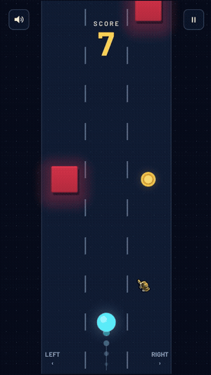
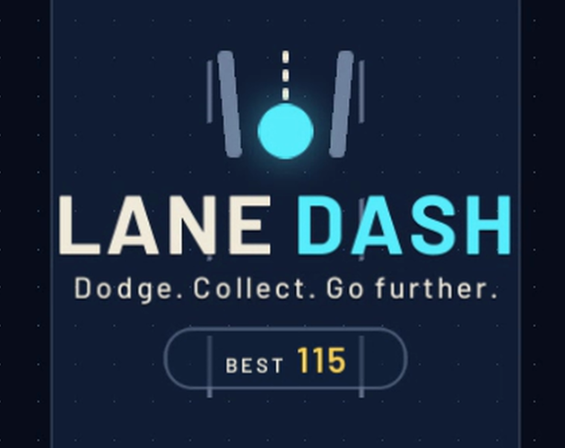

# Lane Dash

**Dodge. Collect. Go further.** A hyper-casual three-lane arcade game for mobile and web, made in Unity.

▶ **Play it in your browser:** https://wallasace.itch.io/lane-dash

  
  &nbsp;&nbsp;
  

## How to play

- Tap the left or right half of the screen (or use ← → / A D) to switch lanes.
- Dodge the red blocks and grab the gold coins (+10 points each).
- The road keeps speeding up — there is always at least one free lane.

## Features

- Neon arcade look: glowing player with a short trail, embossed obstacles with backlight glow, ringed coins and a dot-grid background
- Main menu, pause, game over, credits and a local **top-10 ranking** (saved on the device)
- Procedural sound effects and a 140 bpm chiptune soundtrack, synthesized at runtime — no audio files
- All visuals generated in code — no imported art
- Responsive layout for phones (safe area / notch), desktop and the web (full-screen WebGL template)
- Auto-pause when the app loses focus; in-game sound toggle

## Tech

- **Unity 6.3 LTS** (6000.3.14f1), C#
- uGUI built entirely from code (`Shell.cs`), shared with [Stack Tower](https://github.com/wallasace/stack-tower)
- Runtime audio synthesis (`Sfx.cs`, `Music.cs`) and "juice" effects (`Juice.cs`: screen shake, particles, pop)
- Visual tuning panel in the editor: **Tools > Ajustes Visuais**

## Running the project

1. Open the folder in **Unity Hub** (*Add project from disk*) with Unity 6000.3.14f1.
2. Open `Assets/Scenes/Main.unity` and press **Play**. Everything is created at runtime.
3. Web build: *File > Build Profiles > Web*. The project ships with a responsive WebGL template.

## Credits

- Created by **wallasace** — [X / Twitter](https://x.com/wall_as_ace) · [GitHub](https://github.com/wallasace)
- Music and sound effects: wallasace (generated in code)
- Typeface: [Barlow](https://github.com/jpt/barlow) by Jeremy Tribby — SIL Open Font License 1.1
- X and GitHub icons: [Simple Icons](https://simpleicons.org) (CC0); trademarks of their owners
